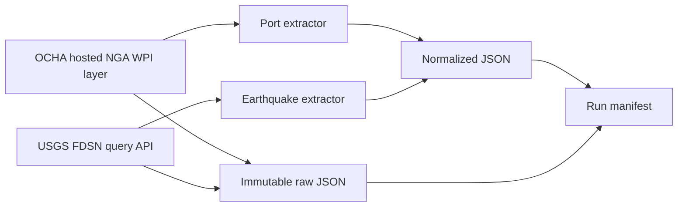

# SupplyWatch

SupplyWatch is a data foundation for monitoring potential environmental exposure around global ports. It consolidates authentic port locations and observed earthquake events so future milestones can assess geographic proximity and environmental conditions. An earthquake near a port does not mean the port is closed; forecasts do not establish shipping delays.

## Day 1 architecture



## Sources

- Ports: OCHA GIS public ArcGIS REST layer based on NGA World Port Index Pub 150. It provides WPI index, name, country and geometry. Details and attribution caveats are in [DATA_SOURCES.md](docs/DATA_SOURCES.md).
- Earthquakes: USGS FDSN Event Web Service query endpoint, requesting GeoJSON for a configurable date range (seven days by default).
- Open-Meteo Marine API was investigated for later use; no forecast ingestion is implemented.

## Stack

Python 3.11+, Requests, JSON, Pytest. PostgreSQL, dbt, Airflow, Streamlit and Docker are planned for later milestones.

## Install and configure

```powershell
python -m venv .venv
.\.venv\Scripts\Activate.ps1
python -m pip install -r requirements.txt
Copy-Item .env.example .env
```

Settings are read from process environment variables; Python does not load `.env` automatically. Set desired variables in the shell or use a local environment loader. No API credentials are needed for the implemented public endpoints.

Configurable variables include `SUPPLYWATCH_ENV`, `LOG_LEVEL`, `USGS_BASE_URL`, `USGS_DAYS`, `HTTP_CONNECT_TIMEOUT`, `HTTP_READ_TIMEOUT`, `HTTP_MAX_RETRIES`, `RAW_DATA_DIR`, and `PORTS_URL`.

## Run

```powershell
python main.py
```

The pipeline independently retrieves ports and earthquakes, saves successful raw and normalized data, writes a UTC manifest, and returns a nonzero exit code if either source fails. A verified 2026-11-02 run completed with `success`: ports 3,689 retrieved / 3,687 normalized (2 invalid); earthquakes 1,817 retrieved / 1,817 normalized (0 invalid, 0 duplicates). The run ID and exact paths are recorded in `data/raw/manifests/2026/11/ingestion_a7920caf0c5341169774b30bcef34a06.json`. Unit tests use mocked data and do not access public services.

## Tests

```powershell
python -m pytest -q
```

Tests cover HTTP retry behavior, schema normalization/validation, duplicates, empty/malformed payloads, and storage uniqueness/manifests.

## Storage

Raw source payloads are kept under `data/raw/<source>/YYYY/MM/`; manifests under `data/raw/manifests/YYYY/MM/`; normalized Day 1 records under `data/processed/<source>/YYYY/MM/`. Filenames include UTC microseconds and a unique run ID. Existing files are opened exclusively and never overwritten.

## Project structure

```text
config/                  environment settings
ingestion/clients/       reusable HTTP client
ingestion/extractors/    port and earthquake source logic
ingestion/models/        normalized records
ingestion/storage/       raw, normalized and manifest JSON
tests/                   isolated mocked tests
docs/                    source and architecture notes
scripts/                 runnable entry point
data/                    generated local data (not committed)
```

## Status

Implemented on Day 1: public-source research, source-specific extractors, validation and duplicate accounting, immutable raw capture, normalized outputs, manifests, partial failure handling, logging and unit tests. Live outcomes must be verified from a pipeline run and manifest; no sample execution counts are fabricated here.

Planned: **Day 2** PostgreSQL Bronze/Silver layers, cleaning, deduplication and geospatial distance association; **Day 3** analytical models and exposure indicators; **Day 4** Airflow orchestration and Streamlit dashboard; **Day 5** Docker, end-to-end recovery, performance and production documentation.

## Limitations and attribution

Port data is a hosted WPI-derived layer and its refresh schedule and layer-specific reuse terms are unclear. Attribute both NGA WPI and OCHA GIS and verify current terms before redistribution. USGS records can be revised, and optional properties can be null. Proximity is not proof of operational impact. Marine forecasts are not navigation advice. See [source notes](docs/DATA_SOURCES.md) and [architecture](docs/ARCHITECTURE.md).
