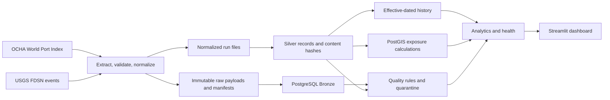

# SupplyWatch

SupplyWatch is a data engineering portfolio project that combines a global port index with observed USGS earthquake events and calculates geographic proximity. It demonstrates source ingestion, immutable raw capture, Bronze/Silver storage, effective-dated history, data quality, quarantine, PostGIS analytics, pipeline health, and a database-backed dashboard. Nearby environmental events are signals for review; they do not prove port damage, closure, or shipping disruption.

## Features

- OCHA hosted NGA World Port Index and USGS FDSN GeoJSON ingestion.
- Raw payload preservation, normalized extracts, and per-run manifests.
- PostgreSQL/PostGIS Bronze, Silver, history, quality, quarantine, and exposure tables.
- Idempotent loading, content hashes, change tracking, as-of queries, and baseline initialization.
- PostGIS geography distances with exclusive 50, 100, and 250 km bands.
- Configurable source freshness, persisted quality results, and health reporting.
- Streamlit views for overview, port exploration, exposure, history, quality, and pipeline monitoring.

## Architecture



## Technology

Python 3.11+, Requests, SQLAlchemy, Alembic, PostgreSQL 16 with PostGIS 3.4, GeoAlchemy2, Pytest, pandas, Plotly, Streamlit, Docker Compose.

## Data sources and limits

- [OCHA GIS hosted World Port Index layer](https://gis.unocha.org/server/rest/services/Hosted/global_world_seaport_index_202511/FeatureServer/0): WPI-derived port identities, names, countries, and locations. The layer's update frequency and redistribution terms should be confirmed with the provider.
- [USGS FDSN Event Web Service](https://earthquake.usgs.gov/fdsnws/event/1/): GeoJSON earthquake events; records and event details can be revised and optional values may be absent.

Source coverage is limited to these feeds and their available fields. Port/event distance is environmental exposure intelligence, not confirmed operational impact. History begins with what the database has observed; a baseline is not evidence of earlier changes. Freshness is measured from successful ingestion, with configured operational targets of 168 hours for ports and 24 hours for USGS. External service availability and source update schedules are outside this project.

## Database design

Bronze stores each source feature and run-scoped payload hash. Silver contains validated current ports and earthquakes with WGS84 geography points, source provenance, timestamps, and content hashes. `record_history` stores effective-dated observed versions. `port_event_exposure` stores unique port/event pairs within the configured maximum radius. Quality executions, rule results, issues, and quarantined source payloads persist audit evidence. Invalid records are retained in Bronze/quarantine and excluded from Silver; there is no automatic quarantine release.

## Windows setup

```powershell
python -m venv .venv
.\.venv\Scripts\Activate.ps1
python -m pip install -r requirements.txt
Copy-Item .env.example .env
```

Edit `.env` for local database credentials and ensure `DATABASE_URL` uses the same host port and credentials as Compose. `.env` is ignored by git. The example values are local development placeholders, not production credentials.

### Database and migrations

```powershell
docker compose up -d db
docker compose ps
alembic upgrade head
python -m scripts.check_database
```

The named `supplywatch_pgdata` volume preserves database contents. `docker compose down -v` deletes it and should not be used when preserving existing data.

### Run ingestion and full pipeline

```powershell
python main.py                         # extract, validate, raw + normalized files, manifest
python -m scripts.run_full_pipeline    # ingestion through load, exposure, quality and health
```

The full command returns nonzero if a source or required stage fails, or health is stale/failed. Quality findings remain visible and are not suppressed. `UNKNOWN` is reported when no successful evidence exists. For individual operations use `python -m scripts.load_database --help`, `python -m scripts.calculate_exposure`, `python -m scripts.run_quality_checks --dataset all`, `python -m scripts.pipeline_health`, `python -m scripts.quarantine_report`, and `python -m scripts.history_report --help` (the latter provides subcommands).

### Freshness settings

`FRESHNESS_THRESHOLDS_HOURS` accepts comma-separated exact source names and positive hour values. Defaults are `OCHA GIS hosted layer: NGA World Port Index (Pub 150)=168` and `USGS FDSN Event Web Service=24`. These are operating targets, not provider guarantees. Health classifications are `FRESH`, `STALE`, `UNKNOWN`, or `FAILED`. A failed attempt does not change the timestamp of the most recent successful attempt; it is reported separately and classified `FAILED` when it is the latest attempt.

Other settings include `DATABASE_URL`, Compose's `POSTGRES_DB`, `POSTGRES_USER`, `POSTGRES_PASSWORD`, `POSTGRES_PORT`, `USGS_BASE_URL`, `USGS_DAYS`, `PORTS_URL`, `HTTP_CONNECT_TIMEOUT`, `HTTP_READ_TIMEOUT`, `HTTP_MAX_RETRIES`, `RAW_DATA_DIR`, `EXPOSURE_THRESHOLDS_KM`, `LOG_LEVEL`, and optional `USGS_SUPPORTED_MAGNITUDE_TYPES`. See `.env.example`.

### Dashboard

```powershell
streamlit run dashboard.py
```

The dashboard queries the configured database and provides Overview, Global Port Explorer, Exposure Intelligence, Historical Analytics, Data Quality, and Pipeline Monitoring sections. Empty and connection-error states are shown when no records or database are available.

## Tests

```powershell
python -m pytest -q
```

PostgreSQL/PostGIS tests are opt-in and require a separate disposable database, migrated to head. Set both `DATABASE_URL` and `SUPPLYWATCH_TEST_DATABASE_URL` to that test database before running the suite. Integration fixtures use rolled-back transactions. Never point integration tests at a database whose contents must be preserved.

## Documentation

See [architecture](docs/ARCHITECTURE.md), [data sources](docs/DATA_SOURCES.md), [data quality](docs/DATA_QUALITY.md), [observability](docs/OBSERVABILITY.md), and the [Day 1](docs/DAY_1_IMPLEMENTATION.md), [Day 2](docs/DAY_2_IMPLEMENTATION.md), [Day 3](docs/DAY_3_IMPLEMENTATION.md), and [Day 4](docs/DAY_4_IMPLEMENTATION.md) records. Final audit and demonstration notes: [final project report](docs/FINAL_PROJECT_REPORT.md), [validation report](docs/FINAL_VALIDATION_REPORT.md), and [demo guide](docs/PROJECT_DEMO_GUIDE.md).

## Limitations and next steps

There is no orchestration service; the supported local workflow is a Python CLI. Current spatial analysis covers earthquakes only. Exposure rows describe current stored observations and are refreshed, not maintained as an independent exposure time series. Historical queries cannot recover events from before observation began. Before production use, add deployment security, operational alerting, provider terms review, and an explicitly managed backup/restore plan.

## Portfolio summary

SupplyWatch is a Python/PostGIS data platform that ingests a port index and earthquake events, preserves raw evidence, tracks validated current and historical records, measures geodesic exposure, audits quality issues, and presents database-backed intelligence through a Streamlit dashboard. It demonstrates repeatable ingestion, idempotent loading, spatial SQL, history, quarantine, and transparent operational health without equating proximity with disruption.
