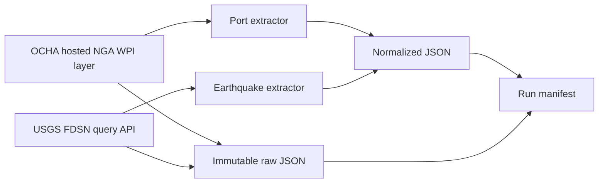

# SupplyWatch

SupplyWatch is a data foundation for monitoring potential environmental exposure around global ports. It consolidates authentic port locations and observed earthquake events so future milestones can assess geographic proximity and environmental conditions. An earthquake near a port does not mean the port is closed; forecasts do not establish shipping delays.

## Day 1 architecture



## Sources

- Ports: OCHA GIS public ArcGIS REST layer based on NGA World Port Index Pub 150. It provides WPI index, name, country and geometry. Details and attribution caveats are in [DATA_SOURCES.md](docs/DATA_SOURCES.md).
- Earthquakes: USGS FDSN Event Web Service query endpoint, requesting GeoJSON for a configurable date range (seven days by default).
- Open-Meteo Marine API was investigated for later use; no forecast ingestion is implemented.

## Stack

Python 3.11+, Requests, JSON, SQLAlchemy, Alembic, PostgreSQL/PostGIS, Pytest and Docker Compose. dbt, Airflow and Streamlit remain later milestones.

## Install and configure

```powershell
python -m venv .venv
.\.venv\Scripts\Activate.ps1
python -m pip install -r requirements.txt
Copy-Item .env.example .env
```

Settings are read from process environment variables; Python does not load `.env` automatically. Set desired variables in the shell or use a local environment loader. No API credentials are needed for the implemented public endpoints.

Configurable variables include `SUPPLYWATCH_ENV`, `LOG_LEVEL`, `USGS_BASE_URL`, `USGS_DAYS`, `HTTP_CONNECT_TIMEOUT`, `HTTP_READ_TIMEOUT`, `HTTP_MAX_RETRIES`, `RAW_DATA_DIR`, and `PORTS_URL`.

## Run

```powershell
python main.py
```

The pipeline independently retrieves ports and earthquakes, saves successful raw and normalized data, writes a UTC manifest, and returns a nonzero exit code if either source fails. A verified 2026-11-02 run completed with `success`: ports 3,689 retrieved / 3,687 normalized (2 invalid); earthquakes 1,817 retrieved / 1,817 normalized (0 invalid, 0 duplicates). The run ID and exact paths are recorded in `data/raw/manifests/2026/11/ingestion_a7920caf0c5341169774b30bcef34a06.json`. Unit tests use mocked data and do not access public services.

## Tests

```powershell
python -m pytest -q
```

Tests cover HTTP retry behavior, schema normalization/validation, duplicates, empty/malformed payloads, and storage uniqueness/manifests.

## Storage

Raw source payloads are kept under `data/raw/<source>/YYYY/MM/`; manifests under `data/raw/manifests/YYYY/MM/`; normalized Day 1 records under `data/processed/<source>/YYYY/MM/`. Filenames include UTC microseconds and a unique run ID. Existing files are opened exclusively and never overwritten.

## Project structure

```text
config/                  environment settings
ingestion/clients/       reusable HTTP client
ingestion/extractors/    port and earthquake source logic
ingestion/models/        normalized records
ingestion/storage/       raw, normalized and manifest JSON
tests/                   isolated mocked tests
docs/                    source and architecture notes
scripts/                 runnable entry point
data/                    generated local data (not committed)
```

## Status

Implemented on Day 1: public-source research, source-specific extractors, validation and duplicate accounting, immutable raw capture, normalized outputs, manifests, partial failure handling, logging and unit tests. Live outcomes must be verified from a pipeline run and manifest; no sample execution counts are fabricated here.

## Day 2 — Geospatial Intelligence and Database Engineering

Day 2 adds a PostGIS database with immutable-per-run Bronze source evidence, normalized Silver records, and a persisted earthquake-to-port exposure table. It associates only observed event/port coordinates and does not label proximity as disruption.

### Start and migrate

```powershell
Copy-Item .env.example .env
# Edit POSTGRES_PASSWORD and DATABASE_URL together for local use.
docker compose up -d
docker compose ps
python -m pip install -r requirements.txt
alembic upgrade head
python -m scripts.check_database
```

`check_database` runs `SELECT PostGIS_Version()`. Connect with `docker compose exec db psql -U supplywatch -d supplywatch`, and verify the extension with `SELECT PostGIS_Version();`. Stop the database with `docker compose down`; the named volume retains data. `docker compose down -v` removes that volume and is destructive.

Set `DATABASE_URL`, `POSTGRES_DB`, `POSTGRES_USER`, `POSTGRES_PASSWORD`, `POSTGRES_PORT` and `EXPOSURE_THRESHOLDS_KM` through the environment. `.env` is ignored by git. Compose defaults are for local development only; choose a private password before use.

### Bronze and Silver

Alembic creates `bronze_ports`, `bronze_earthquakes`, `silver_ports`, `silver_earthquakes`, and `port_event_exposure`. Bronze stores each source GeoJSON feature as JSONB together with source ID, run ID, payload hash, and ingestion time. A run-scoped hash prevents duplicate capture on reruns while allowing source changes to be preserved in later runs. Silver uses stable WPI `index_no` and USGS event IDs as primary keys, validates coordinate ranges, and builds SRID 4326 points. Spatial columns use PostGIS `geography(Point,4326)`: its meter-based geodesic distance supports global proximity calculations without treating degrees as planar distances. GiST indexes support spatial filters.

Load the latest successful manifest run with `python -m scripts.load_database`, or choose one with `python -m scripts.load_database --run-id a7920caf0c5341169774b30bcef34a06`. `--raw-dir` and `--processed-dir` select alternate input roots. Re-running a run is idempotent; new source runs append Bronze evidence and upsert Silver by stable identity. Missing source records are retained rather than deleted.

### Exposure and queries

Run `python -m scripts.calculate_exposure`. PostGIS filters candidates with `ST_DWithin(geography, geography, max_meters)` and computes exact meter distances with `ST_Distance`; point creation uses longitude before latitude. `EXPOSURE_THRESHOLDS_KM=50,100,250` controls nested closest-applicable bands. Each pair is stored once and refreshed on recalculation. These are proximity bands, not damage thresholds.

Useful queries:

```sql
SELECT port_id, event_id, distance_km, proximity_band
FROM port_event_exposure ORDER BY distance_meters LIMIT 20;

SELECT p.country, count(DISTINCT p.port_id)
FROM silver_ports p JOIN port_event_exposure e USING (port_id)
GROUP BY p.country ORDER BY 2 DESC;

SELECT PostGIS_Version();
```

`python -m scripts.database_report` returns counts and distance band distribution from the database. Python analytics in `analytics/queries.py` also provides nearest-event, per-port-event, country grouping and latest event queries.

### Tests and execution status

Run `python -m pytest -q`. Day 1's 14 tests remain intact. On this run, 19 tests passed and 3 opt-in PostgreSQL/PostGIS integration checks were skipped because `SUPPLYWATCH_TEST_DATABASE_URL` was not configured. Day 2 unit tests cover ORM tables, geography configuration and invalid coordinate/threshold handling. The latest successful Day 1 run `a7920caf0c5341169774b30bcef34a06` contains 3,689 raw port features, 3,687 normalized ports, and 1,817 raw and normalized earthquake features. Docker CLI/Compose are present, but the local Docker engine was unavailable and its service could not be started. A native PostgreSQL 18 service is running, but it rejected the configured `supplywatch` credentials. Therefore no database migration, PostGIS version, Bronze/Silver load, exposure calculation, or database-backed count is claimed as executed. Start Docker Desktop or configure credentials for a disposable PostGIS database, then run the commands above to produce those live statistics.

Known limits: the pipeline loads the most recent successful run by default, does not delete events omitted from a later feed, and keeps current exposure pairs rather than a full calculation-history table. Bronze preserves run evidence for later history/versioning. Day 3 can add broader environmental sources and dated exposure snapshots without converting proximity into a disruption claim.

Planned: Day 3 analytical models and indicators; Day 4 orchestration and dashboard; later reliability and performance work.

## Limitations and attribution

Port data is a hosted WPI-derived layer and its refresh schedule and layer-specific reuse terms are unclear. Attribute both NGA WPI and OCHA GIS and verify current terms before redistribution. USGS records can be revised, and optional properties can be null. Proximity is not proof of operational impact. Marine forecasts are not navigation advice. See [source notes](docs/DATA_SOURCES.md) and [architecture](docs/ARCHITECTURE.md).
