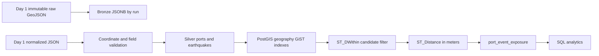
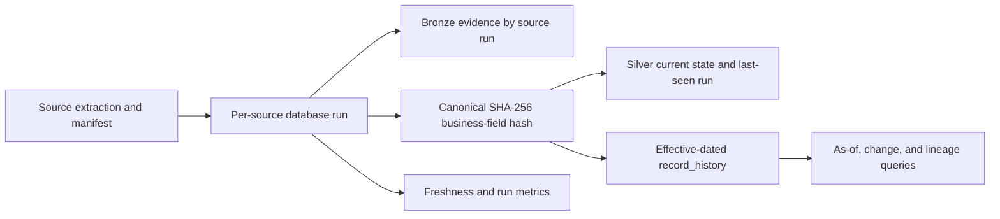

# Day 1 architecture

`main.py` coordinates configuration, one reusable `requests.Session` HTTP client, source extractors and file storage. Each source is handled independently: the complete original response is written to `data/raw/<source>/YYYY/MM/`, then validated records are written under `data/processed/<source>/YYYY/MM/`. One UTC manifest per run captures source state, counts, date range, paths, duration and errors.

The HTTP client uses bounded retries for connection/timeouts, HTTP 429 and server errors, honors numeric or HTTP-date `Retry-After`, and immediately surfaces permanent HTTP failures. Extractors validate required IDs/names, coordinate ranges and timestamps, count invalid entries and remove duplicate IDs. A source failure does not discard the other source's results; the overall exit code is nonzero and the manifest says `partial_failure`.

Raw payloads are immutable, uniquely named JSON files and are never replaced. Normalized outputs are deliberately separate and lightweight for Day 1. The manifest contains no credentials. Event timestamps and ingestion timestamps use UTC.

## Day 2 data platform

Bronze retains original feature payloads, source IDs where present, run IDs, hashes and ingestion timestamps. Silver keys ports by WPI `index_no` and events by USGS event ID. Geographic point columns use `geography(Point,4326)` for ellipsoidal distance in meters and GiST indexing. The exposure processor filters at the maximum configured radius (default 250 km), assigns one closest applicable band, and upserts each unique pair. A 1 mm numerical tolerance keeps constructed points at a configured boundary inclusive despite floating point behavior. Missing events in a later feed are not deleted. Exposure is geographic proximity evidence only.

Live validation on 2026-11-03 used PostgreSQL 16.4/PostGIS 3.4. The 3,689 Bronze port features, 1,817 Bronze earthquakes, 3,687 Silver ports, and 1,817 Silver events produced 28,028 exposure pairs. Four isolated PostGIS integration tests and 19 other tests passed; the integration fixture transaction was rolled back.

The implementation entry points and actual environment constraints are recorded in [DAY_2_IMPLEMENTATION.md](DAY_2_IMPLEMENTATION.md).

## Day 3 historical processing

Day 3 adds `ingestion_runs` and `record_history`, while extending Silver rows with nullable `content_hash` and `last_seen_run_id`. History is effective-dated and stores source identity, normalized snapshot, source run lineage, and the observed time. Existing rows receive their available baseline on their next actual observation; no synthetic pre-migration versions are inserted. The loader hashes explicitly tracked port and earthquake fields, excluding ingestion metadata and exposure relationships. It leaves absent rows untouched, and measures missing observations only for explicitly complete snapshots. See [DAY_3_IMPLEMENTATION.md](DAY_3_IMPLEMENTATION.md) for schema, completeness rules, CLI, tests, and verification state.
