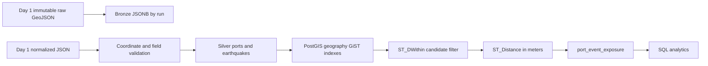

# Day 1 architecture

`main.py` coordinates configuration, one reusable `requests.Session` HTTP client, source extractors and file storage. Each source is handled independently: the complete original response is written to `data/raw/<source>/YYYY/MM/`, then validated records are written under `data/processed/<source>/YYYY/MM/`. One UTC manifest per run captures source state, counts, date range, paths, duration and errors.

The HTTP client uses bounded retries for connection/timeouts, HTTP 429 and server errors, honors numeric or HTTP-date `Retry-After`, and immediately surfaces permanent HTTP failures. Extractors validate required IDs/names, coordinate ranges and timestamps, count invalid entries and remove duplicate IDs. A source failure does not discard the other source's results; the overall exit code is nonzero and the manifest says `partial_failure`.

Raw payloads are immutable, uniquely named JSON files and are never replaced. Normalized outputs are deliberately separate and lightweight for Day 1. The manifest contains no credentials. Event timestamps and ingestion timestamps use UTC.

## Day 2 data platform

Bronze retains original feature payloads, source IDs where present, run IDs, hashes and ingestion timestamps. Silver keys ports by WPI `index_no` and events by USGS event ID. Geographic point columns use `geography(Point,4326)` for ellipsoidal distance in meters and GiST indexing. The exposure processor filters at the maximum configured radius (default 250 km), assigns one closest applicable band, and upserts each unique pair. Missing events in a later feed are not deleted. Exposure is geographic proximity evidence only.

The implementation entry points and actual environment constraints are recorded in [DAY_2_IMPLEMENTATION.md](DAY_2_IMPLEMENTATION.md).
