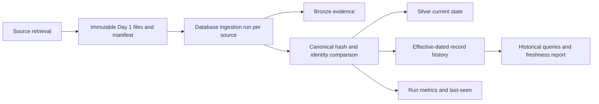

# Day 3 implementation design (proposed)

## Additive schema and data flow

Day 1 remains responsible for fetching and validating source data and writing immutable raw, normalized, and manifest files. The existing Day 2 loader remains the database entry point. It will create a database run row for each source represented by a manifest, append Bronze evidence under existing idempotency rules, compare normalized records by stable source ID and canonical business-field SHA-256, update Silver current state only when content changes, and write effective-dated history in the same transaction.

The additive migration will create `ingestion_runs` (one row per source per run, with source completeness, UTC lifecycle timestamps, metrics, and manifest metadata) and `record_history` (versioned JSONB snapshots linked to the source run). Silver tables gain nullable `content_hash` and `last_seen_run_id` columns. Hashes are nullable during rollout because existing rows predate this migration; their first subsequent observation establishes a baseline version. Existing Bronze, Silver, exposure, and migration data are retained. Existing source identifiers remain the identity keys.

Ports are hashed over `port_id`, `port_name`, `country`, `latitude`, `longitude`, `source`, and `source_updated_at`. Earthquakes are hashed over `event_id`, `magnitude`, `magnitude_type`, `place`, `event_time`, `latitude`, `longitude`, `depth_km`, `event_url`, `event_type`, and `source`. Ingestion/processing timestamps, USGS status, raw payload ordering, and calculated exposure relationships are excluded. Canonical JSON sorts keys, represents datetimes as UTC ISO-8601, normalizes finite numeric values, preserves null, and feeds SHA-256.

`record_history` keeps one open version per `(source_name, source_record_id, record_type)` and immutable closed versions. First observation creates an initial version; changed content closes the prior row and inserts a new row; identical content only updates last-seen/run metrics. Missing identities are never deleted. A source snapshot is complete only where the source manifest says so; the current Day 1 manifests do not yet claim completeness, therefore missing counts remain unknown and no deletion is inferred.

This is the proposal; implementation details and verification results will be appended below after coding and database validation.

## Implementation notes

Migration `0002_historical_processing` adds the run ledger and history table, indexes and checks, and nullable hashes/last-seen IDs to both Silver tables. It tolerates a fresh database where the metadata-driven `0001_initial` may already have created additive structures. Downgrade is intentionally blocked to avoid deleting audit history.

The loader creates one `(run_id, source_name)` row per source, uses manifest retrieval and completion times, and commits writes inside the caller's transaction. A replay of an already terminal database run is rejected so the ledger is not rewritten; a new source execution uses its own Day 1 run ID. Unexpected database errors roll back the source load transaction. Historical query functions live in `processing/history.py`; freshness and change summaries live in `analytics/historical.py`. CLI entry: `python -m scripts.history_report --help`.

Ports can be called complete when every paginated ArcGIS request succeeded and the final page was short without `exceededTransferLimit`. USGS is complete only when response metadata reports a count equal to the returned feature count; a larger count is partial and missing metadata leaves completeness unknown. Older Day 1 files have no completeness attestation and remain `unknown`.

Freshness reports distinguish run start (`latest_attempted_at`, ingestion start), run completion (`latest_attempt_completed_at`, processing completion), earthquake event occurrence (`latest_source_event_time`), and port source publication/update (`latest_source_publication_or_update_time`, often unavailable for this WPI feed). Historical record payloads also retain `event_time` or `source_updated_at` alongside `observed_at` and `valid_from`.

PostgreSQL tests are opt-in via `SUPPLYWATCH_TEST_DATABASE_URL` and should run against a disposable migrated database.

## Live verification (2026-11-04)

Docker Desktop 4.86.0 / Engine 29.7.2 was available. Existing container `supplywatch-db-1` was healthy on host port 5433, backed by the existing named volume `supplywatch_supplywatch_pgdata`; no volume was removed or recreated. The configured database connected as `supplywatch`, reporting PostgreSQL 16.4 and PostGIS 3.4.

Before migration, Alembic was at `0001_initial`; Silver contained 3,687 ports and 1,817 earthquakes, with 28,028 exposure rows. After `alembic upgrade head`, revision was `0002_historical_processing`, and all three counts were unchanged. The new tables and Silver columns were present. A read-only PostGIS geography distance check returned 111,319.491 meters for one degree at the equator. The production-like database had zero `ingestion_runs`, zero `record_history` rows, and no hashes populated on existing Silver rows after migration; initial versions will be established on a real subsequent load. No historical baseline rows were invented.

The pre-existing `supplywatch_test` database was inspected first: it was at revision `0001_initial` with zero source/exposure rows. It was migrated to head and used for all PostgreSQL tests. The controlled three-run scenario used IDs `SW_DAY3_LIVE_20261104_0`, `_1`, and `_2` inside a rollback-only transaction. Source totals per run were `(new, updated, unchanged)`: `(2,0,0)`, `(0,0,2)`, `(0,1,1)`; rejected records were zero. The two port history versions were `Live baseline` (closed at 2026-11-03 UTC) and `Live updated` (current). The as-of lookup before the change returned `Live baseline`; the current Silver row and current history hash both matched the new SHA-256. Six source-run rows were completed with accurate per-source metrics. This controlled fixture transaction was rolled back after capturing the SQL results.

Completeness integration checks found one missing port for a complete snapshot and kept the Silver row. Partial, failed, and unknown snapshots produced no missing count and also retained the row. The row's last-seen run remained its last actual observation. Freshness with a test threshold of 1,000,000 hours reported 24 hours since the last successful controlled run and `stale: false`; a separate integration assertion reported stale at a configured 1-hour threshold after a failed latest attempt, and `stale: null` for a source with no successful run. The project `.env` has no freshness thresholds configured, so the actual main-database freshness and run-history CLI reports returned empty arrays because it has no database-tracked runs yet.

Rollback verification injected a PostgreSQL trigger failure during a changed Silver update. The savepoint restored Silver's prior value/hash, left history version count unchanged, and inserted no Bronze rows for the failed run. The failure-recording helper then recorded failed run state in the test transaction. The outer test transaction was rolled back, leaving no fixture records behind.

Full regression run with `SUPPLYWATCH_TEST_DATABASE_URL` set: **32 passed, 0 failed, 0 skipped** (Day 1, Day 2, Day 3 unit, PostgreSQL, and PostGIS checks). `compileall`, both loader/history CLI help checks, and read-only main database report checks also succeeded.
