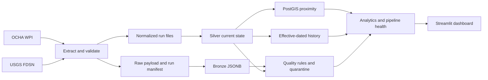

# Final project report

**Project:** SupplyWatch — Global Port Disruption & Supply Chain Risk Intelligence Platform  
**Report date:** 2026-11-06

## 1. Summary

SupplyWatch ingests an OCHA-hosted NGA World Port Index layer and USGS earthquake events, preserves raw source evidence, validates normalized records, stores Bronze/Silver data in PostgreSQL/PostGIS, tracks observed history, calculates geodesic proximity, persists quality findings and quarantines, and offers a Streamlit dashboard. Proximity is environmental exposure intelligence and does not establish operational disruption.

The repository now includes an integrated local pipeline command, configurable freshness thresholds, a database-backed dashboard, and consolidated run instructions. Live database and end-to-end validation remain incomplete because Docker was unavailable and the configured database timed out.

## 2. Architecture



## 3. Capabilities

- Source-specific extraction with raw preservation, validation, normalized files, run metadata, and partial failure reporting.
- Bronze and Silver PostgreSQL storage with coordinate checks and PostGIS geography indexes.
- Idempotent loading, content fingerprints, historical versions, as-of queries, and baseline initialization.
- Earthquake proximity relationships, exclusive distance bands, nearest event and threshold summaries.
- Quality rules, persistent executions/issues, quarantine evidence, and guarded revalidation.
- Source freshness, run health, historical coverage and quarantine reporting.
- Local integrated pipeline CLI and real-database Streamlit dashboard.

## 4. Outstanding issues

**High impact:** live database and Docker were unavailable. Current database contents and migration state cannot be attested; the prior two quarantined port features were not re-inspected.  
**High impact:** full end-to-end, live PostGIS integration, and idempotency validation were not run in this phase.  
**Medium impact:** Streamlit layout and SQL behavior were not checked against a live database.  
**Medium impact:** source service terms/cadence and historical coverage before first observation remain external/data limitations.

## 5. Database validation

Current Bronze/Silver/historical/exposure counts: **unavailable**. Quality issue and quarantine counts: **unavailable**. Current Alembic revision: **unavailable**. The configured endpoint `localhost:5433` timed out. Previous phase notes contain counts but do not constitute current results. The database volume was not reset, deleted, or modified.

## 6. Data quality

The codebase contains source validators, Silver integrity checks, historical/exposure checks, persisted quality executions and quarantine transitions. Current scorecards and open/resolved findings could not be queried. Previous notes reported two malformed duplicate-ID port features in quarantine; the current payloads and status remain unverified. No data was silently discarded or corrected in this phase.

## 7. Pipeline validation

The new `scripts.run_full_pipeline` composes extraction, Bronze/Silver/history loading, idempotent baseline initialization, exposure calculation, quality checks, health, and stored-data summary in a database transaction. It was not executed end-to-end because the database and Docker engine were unavailable. Unit tests do not prove live execution.

## 8. Dashboard validation

Implemented dashboard sections: Overview, Global Port Explorer, Exposure Intelligence, Historical Analytics, Data Quality, and Pipeline Monitoring. Queries use actual database tables; the dashboard has a database connection error state and empty-data states. No live UI verification was possible.

## 9. Test results

| Category | Result |
|---|---|
| Unit/regression suite | 30 passed |
| PostgreSQL integration | 9 skipped; disposable test DB not configured |
| PostGIS tests | 9 skipped |
| End-to-end | Not run |
| Dashboard retrieval | Not run |

The suite result is from before this phase's dashboard/orchestrator additions. Re-run after dependencies are installed and use a disposable migrated PostGIS database to complete verification.

## 10. Performance and reliability

The schema and spatial processor use geography GiST indexing, `ST_DWithin` candidate filtering, exact `ST_Distance`, uniqueness constraints, and bulk SQL upserts. The orchestrator wraps database processing steps in a transaction. Query plans, memory use, and dashboard latency were not measured in this phase because no database was accessible. Source ingestion loads GeoJSON into memory, so very large future feeds may require pagination or streaming.

## 11. Documentation

Updated: README, `docs/ARCHITECTURE.md`, and `docs/OBSERVABILITY.md`. Added this report, `docs/FINAL_VALIDATION_REPORT.md`, and `docs/PROJECT_DEMO_GUIDE.md`. Existing source, quality, and Day 1–Day 4 documentation remains in `docs/`.

## 12. Commands

```powershell
docker compose up -d db
alembic current
alembic upgrade head
python -m scripts.check_database
python -m scripts.run_full_pipeline
python -m pytest -q
streamlit run dashboard.py
```

Use a separate disposable database for opt-in integration tests by setting both `DATABASE_URL` and `SUPPLYWATCH_TEST_DATABASE_URL`. Do not run database tests against the preserved working data.

## 13. Git readiness

The repository was not committed or pushed. Review `git status` and `git diff --check` in the checkout before publishing. `.env` remains ignored; `.env.example` contains local placeholder credentials and no production secret. Raw and processed data directories remain ignored. No GitHub release readiness can be claimed until live validation is completed.

## 14. Project status

**PARTIALLY COMPLETE.** Integration code, dashboard, freshness defaults, and documentation were added, and the existing unit suite passed before those additions. The database timeout and unavailable Docker engine prevent checking actual data integrity, inspecting quarantined evidence, validating migrations, executing PostGIS tests, or demonstrating the full pipeline/dashboard against the real database.

## 15. Interview preparation

### Two-minute explanation

SupplyWatch is a Python and PostGIS data platform for exploring potential environmental exposure around global ports. It collects port locations from an OCHA-hosted World Port Index layer and earthquake events from USGS. Every run retains raw source payloads and a manifest, while normalized records are validated and loaded into Bronze and Silver tables. Content hashes distinguish new, changed, and unchanged observations, and an effective-dated history table supports as-of queries. PostGIS geography calculations measure event distance and assign mutually exclusive 50, 100, or 250 km bands. Persistent quality rules surface bad records and preserve them in quarantine rather than silently dropping them. A Streamlit dashboard exposes current data, quality, history, and pipeline status. The system treats proximity as an exposure signal, not proof of port disruption.

### Five engineering decisions

1. Preserve raw payloads so normalized output can be audited and replayed.
2. Use PostGIS geography for global distances measured in meters.
3. Hash explicit business fields so ingestion metadata does not create false updates.
4. Keep invalid source records in quarantine and gate any later reprocessing.
5. Separate last successful ingestion from latest attempt status for honest freshness reporting.

### Five challenges and solutions

1. Coordinate order and distance correctness: create points as longitude/latitude and use geography with PostGIS.
2. Repeated source runs: use source/run/hash uniqueness and idempotent upserts.
3. Historical integrity: close prior versions and maintain a single current version per entity.
4. Malformed source records: retain Bronze evidence and store validation explanations in quarantine.
5. Environmental proximity overclaims: label exposure clearly and avoid inferring disruption.

### Ten likely interview questions

1. Why use PostGIS geography rather than planar geometry for worldwide distances?
2. How does the pipeline avoid duplicate Bronze and Silver records on reruns?
3. Which fields feed a content hash, and why exclude ingestion timestamps?
4. How are historical intervals closed and queried as of a timestamp?
5. What does a complete source snapshot mean, and when can missing records be measured?
6. How are invalid records preserved and prevented from entering Silver?
7. How are exclusive exposure bands different from cumulative radius counts?
8. How does pipeline health distinguish stale data from a failed latest attempt?
9. What database integration tests run, and how are their fixtures isolated?
10. What evidence would be required before describing exposure as an operational disruption?
